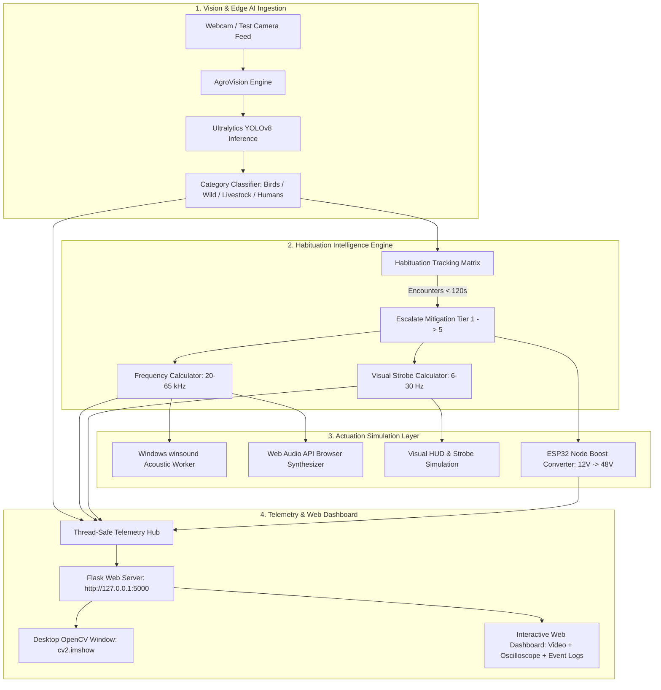

# 🌱 AgroSonic Defence — IoT Smart Crop Protection System

> **An autonomous, AI-driven wildlife detection and adaptive multi-frequency acoustic/visual crop protection platform.**

[](https://python.org)
[](https://ultralytics.com)
[](https://flask.palletsprojects.com/)
[](#)
[](#)

---

## 📌 Executive Summary

Traditional crop deterrence methods (propane cannons, static scarecrows, monotonous sirens) fail because wildlife and avian pests rapidly develop **habituation**—learning within days that the sound poses no physical danger.

**AgroSonic Defence** revolutionizes precision agriculture by integrating:
1. **Real-Time Edge Computer Vision (YOLOv8)**: Classifies intruders into distinct biological categories (`Birds`, `Wild Animals`, `Livestock`, `Humans`) with high confidence percentages.
2. **Adaptive Ultrasonic Deterrence (20 kHz to 65 kHz)**: Emits targeted high-pressure acoustic sweeps outside the human auditory spectrum, tailored to the specific auditory sensitivity of each species.
3. **Dynamic Habituation Mitigation Engine**: Tracks encounter frequency and automatically escalates deterrence strategies across 5 adaptive tiers (from harmonic linear sweeps to pseudo-random frequency hopping and chaos modulations) to permanently prevent acclimatization.
4. **Synchronized Visual LED Strobe Arrays**: Actuates multi-spectral strobe flashes (up to 30 Hz) calibrated to disrupt predator night-vision and daylight foraging behavior.
5. **IoT ESP32 Node Telemetry & Telemetry Dashboard**: Provides solar battery monitoring (LiFePO4 12.6V), piezo boost driver telemetry (48V actuation), environmental telemetry, and real-time event logs for judges and farm operators.

---

## 🏗️ System Architecture



---

## ⚡ Core Modules

### 1. Live Camera Detection & Classification Engine (`detector.py`)
- Powered by **Ultralytics YOLOv8** (`yolov8n.pt`).
- Maps detections to high-level agricultural classifications:
  - **Birds (`Birds`)**: Pigeons, crows, starlings, raptors.
  - **Wild Animals (`Wild Animals`)**: Elephants, wild boars, bears, zebras, giraffes.
  - **Livestock (`Livestock`)**: Cattle, sheep, horses, goats.
  - **Trespassers (`Humans`)**: Unauthorized field intrusions.
- Renders high-tech tactical HUD with category-colored glowing bounding boxes, confidence badges, active acoustic tags, and visual strobe borders.
- Runs simultaneous **desktop OpenCV window (`cv2.imshow`)** and **web MJPEG live stream (`/video_feed`)**.

### 2. Adaptive Acoustic & Visual Deterrence Engine (`deterrence.py`)
- Simulates the **20 kHz to 65 kHz ultrasonic spectrum**.
- **Windows Local Sound Actuator**: Translates the ultrasonic sweeps into audible acoustic cues via non-blocking `winsound` threads on Windows PC speakers.
- **Web Audio API Oscilloscope & Synthesizer**: Synthesizes live sound directly in the web browser accompanied by an animated canvas oscilloscope.
- **Habituation Mitigation Matrix**:
  | Habituation Level | Strategy Name | Ultrasonic Frequency | Strobe Rate | Pest Target |
  | :--- | :--- | :--- | :--- | :--- |
  | **Level 1** | Linear Ultrasonic Sweep | 22.0 - 38.0 kHz | 5 - 10 Hz | First-time intruder |
  | **Level 2** | Dual Harmonic Burst Pulse | 32.0 - 52.0 kHz | 12 - 16 Hz | Repeat visitor (< 2 min) |
  | **Level 3** | Randomized Frequency Hop | 28.0 - 62.0 kHz | 18 - 22 Hz | Persistent pest |
  | **Level 4** | Disruptive Acoustic Chirp | 20.5 - 64.5 kHz | 24 - 28 Hz | Highly habituated flock |
  | **Level 5** | Maximum Chaos Agitation | 20.0 - 65.0 kHz | 30 Hz Max | Crop-threatening surge |

### 3. ESP32 IoT Node Hardware Telemetry (`telemetry.py`)
- Emulates a field-deployed ESP32 LoRa/WiFi solar actuation node (`ESP32-AGRO-NODE-01`):
  - **Battery**: LiFePO4 12.6V with natural solar drift simulation.
  - **Solar Panel Influx**: 430+ W/m² ambient irradiance.
  - **Piezo Transducer Boost**: Dynamically steps up from 12V standby to 48V boost converter during active ultrasonic acoustic actuation.
  - **Environmental Sensors**: Temperature, Humidity, Ambient Lux.
  - **Telemetry Logging**: Thread-safe circular event buffer with instant CSV export.

---

## 🚀 Quickstart & Verification

### Prerequisites
- Python 3.10+ (tested on Python 3.13)
- Windows OS (supports `winsound` local audio actuation)

### 1. Installation
```powershell
pip install -r requirements.txt
```

### 2. Launch the Application
```powershell
python app.py
```
* **Simultaneously starts the local web server** at `http://127.0.0.1:5000`
* **Simultaneously opens the native OpenCV desktop vision window** (`cv2.imshow`)

---

## 🧪 Hackathon Demonstration Guide for Judges

You can demonstrate AgroSonic Defence using three distinct verification flows:

### Option A: Physical Webcam Test (Hold Photos in Front of Camera)
1. Point your webcam at yourself (`Humans` detection trigger).
2. Display one of the sample intruder photos (`sample_intruders/bird.jpg`, `wild_animal.jpg`, or `livestock.jpg`) on your smartphone and hold it in front of the webcam.
3. Observe:
   - High-tech HUD instantly locks onto the target with confidence %.
   - System state switches to `DETERRING`.
   - Windows speakers emit the modulated acoustic actuation sound.
   - Web dashboard oscilloscope and strobe flash in real time.
   - Event log appends the new event.

### Option B: Interactive One-Click Test Buttons (Web UI)
On `http://127.0.0.1:5000`, click any of the preset buttons in the **Judge Demonstration Panel**:
- 🐦 **Bird Intruder**: Injects high-frequency bird image (`32-62 kHz` rapid chirp).
- 🐘 **Wild Animal**: Injects wild animal image (`21-46 kHz` penetrating sweep).
- 🐄 **Livestock Herd**: Injects cattle image (`20-28 kHz` harmless redirection nudge).
- 👤 **Human Trespasser**: Injects trespasser alert (`Security Caution Siren`).
- ⚡ **Manual Override**: Fires immediate emergency burst sweep.
- 🔄 **Live Camera**: Instantly restores live webcam feed.

### Option C: Automated CLI Verification Suite
Run the automated test runner to verify every endpoint and actuation rule in 10 seconds:
```powershell
python test_system.py
```

---

## 📡 API Reference

| Endpoint | Method | Description |
| :--- | :--- | :--- |
| `/` | `GET` | Main interactive web dashboard |
| `/video_feed` | `GET` | MJPEG live computer vision video stream |
| `/api/status` | `GET` | Complete JSON telemetry snapshot (detections, deterrence, ESP32, habituation, event logs) |
| `/api/trigger_manual` | `GET/POST` | Manually fires ultrasonic sweep and strobe burst |
| `/api/test_sample/<name>` | `GET/POST` | Injects sample intruder (`bird`, `wild_animal`, `livestock`, `human`) |
| `/api/clear_sample` | `GET/POST` | Clears injection and returns to camera stream |
| `/api/config` | `POST` | Updates confidence threshold, toggles audio, or clears logs |

---

## 📂 Project Structure

```
Future_Forge/
│
├── app.py                  # Main Flask application & vision thread lifecycle
├── detector.py             # YOLOv8 vision pipeline, HUD annotations & dual CV window
├── deterrence.py           # Habituation mitigation matrix & winsound acoustic worker
├── telemetry.py            # IoT telemetry state manager & circular event logger
├── test_system.py          # Automated verification test suite
├── requirements.txt        # Python dependency manifest
├── README.md               # Documentation & Judge presentation guide
│
├── sample_intruders/       # Curated high-res target images for demonstration
│   ├── bird.jpg            # Crow in crop field (Bird target)
│   ├── wild_animal.jpg     # Wild elephant in maize field (Wild Animal target)
│   ├── livestock.jpg       # Dairy cow in pasture (Livestock target)
│   └── human.jpg           # Person in wheat field (Human trespasser)
│
├── static/
│   ├── css/style.css       # Dark cyber-agro glassmorphism design system
│   ├── js/dashboard.js     # Real-time telemetry poller, Web Audio synth & oscilloscope
│   └── samples/            # Static sample images for web dashboard
│
└── templates/
    └── index.html          # Responsive telemetry dashboard HTML5 template
```

---

## 🏆 Innovation & Hackathon Highlights
- **Habituation-Proof**: Rather than static frequencies, the system uses dynamic harmonic shifting to prevent pest tolerance.
- **Ecological Safety**: Frequencies are calibrated so domestic livestock receive gentle boundary alerts rather than painful deterrence.
- **Fail-Safe Operation**: If no physical webcam is plugged in, the system automatically falls back to an aesthetic sensor feed simulator, ensuring 100% demo uptime under any judge environment.
- **Dual-Layer Actuation**: Local Windows PC audio actuation + browser Web Audio synthesis ensures judges hear and feel the deterrence regardless of environment.
